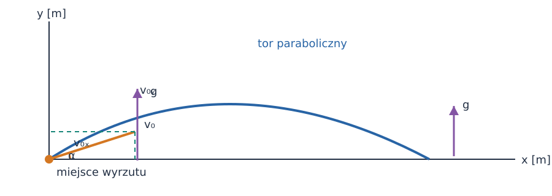
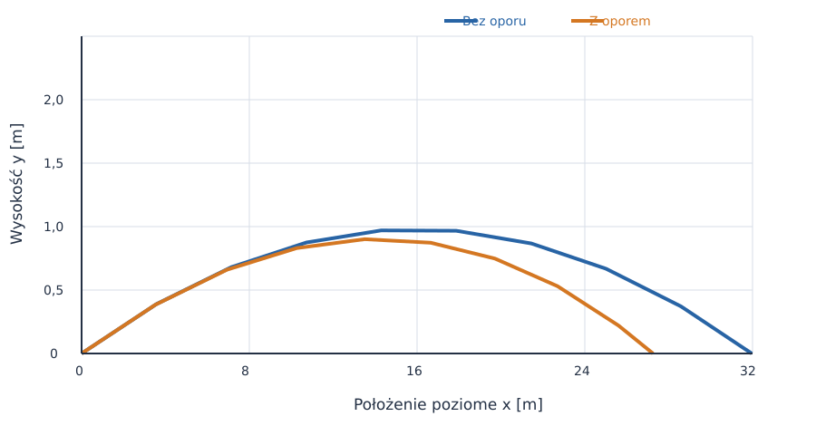
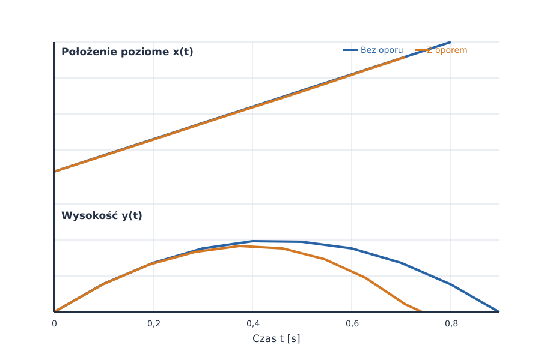
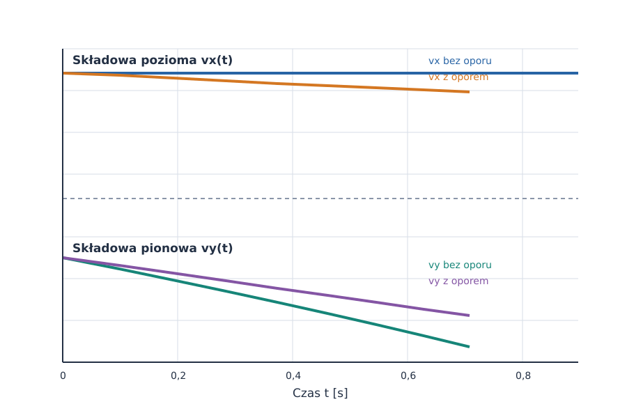
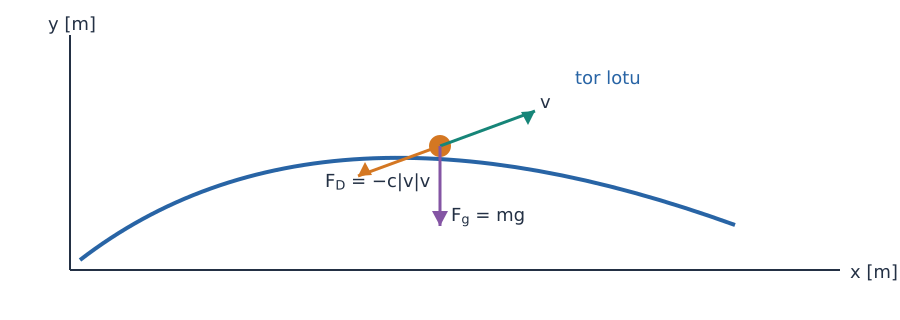
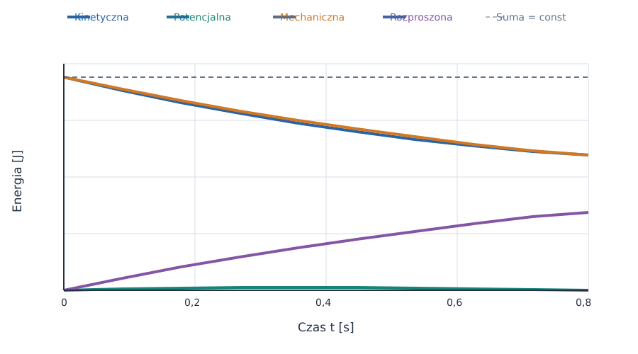
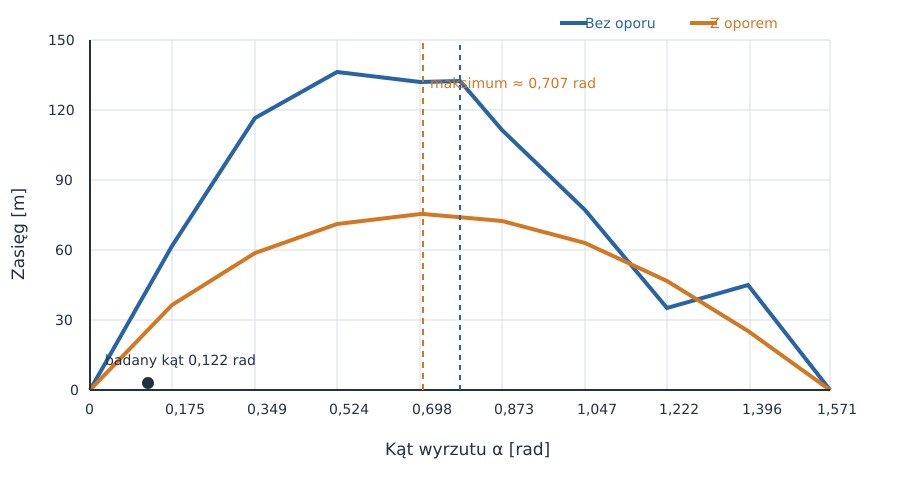

# Rzut ukośny bez oporu i z oporem powietrza

*Raport obliczeniowy: od równań Newtona do symulacji numerycznej.*

**Temat:** ruch ciała wyrzuconego pod kątem do poziomu.  
**Metoda:** wyprowadzenie analityczne, modelowanie oporu i symulacja w Pythonie.  
**Charakter wyników:** obliczenia modelowe, nie pomiary laboratoryjne.

Rzut ukośny można rozłożyć na dwa ruchy: jednostajny w poziomie i jednostajnie zmienny w pionie. To rozdzielenie działa dokładnie, dopóki pomijamy opór powietrza. Gdy opór uwzględnimy, składowe ruchu sprzęgają się przez wartość całkowitej prędkości i rozwiązanie trzeba wyznaczyć numerycznie.

W raporcie prędkość początkowa i kąt odpowiadają podanym cyfrom indeksu: $v_0=36\,\mathrm{m/s}$ oraz $\alpha=7^\circ=0{,}1222\,\mathrm{rad}$. Kąt podajemy równolegle w stopniach dla czytelności i w radianach w równaniach oraz obliczeniach.

## Spis treści

1. [Model bez oporu](#1-model-bez-oporu)
2. [Wyprowadzenie równań bez oporu](#2-wyprowadzenie-równań-bez-oporu)
3. [Wykresy bez oporu](#3-wykresy-bez-oporu)
4. [Model z oporem powietrza](#4-model-z-oporem-powietrza)
5. [Równania ruchu z oporem](#5-równania-ruchu-z-oporem)
6. [Wykresy z oporem](#6-wykresy-z-oporem)
7. [Porównanie i wnioski](#7-porównanie-i-wnioski)
8. [Kod i odtwarzanie wyników](#8-kod-i-odtwarzanie-wyników)

---

## 1. Model bez oporu

Przyjmujemy układ współrzędnych z początkiem w miejscu wyrzutu, osią $x$ skierowaną poziomo, a osią $y$ pionowo w górę. Ciało startuje z poziomu $y_0=0$ z prędkością początkową $v_0$ pod kątem $\alpha$.

Zakładamy, że:

- przyspieszenie grawitacyjne jest stałe i wynosi $g=9{,}81\,\mathrm{m/s^2}$,
- pomijamy opór powietrza, obrót ciała i zmianę jego masy,
- Ziemię traktujemy jako płaską w skali zasięgu, a ruch rozpatrujemy blisko jej powierzchni,
- ciało ląduje na tej samej wysokości, z której zostało wyrzucone.



*Rysunek 1.* Schemat modelu. Składowa $v_{0x}$ jest stała, natomiast $v_y$ zmienia się pod wpływem grawitacji.

### Wielkości i parametry

| Symbol | Znaczenie | Wartość lub jednostka SI |
| :--- | :--- | :---: |
| $v_0$ | wartość prędkości początkowej | $36\,\mathrm{m/s}$ |
| $\alpha$ | kąt wyrzutu | $0{,}1222\,\mathrm{rad}$ ($7^\circ$) |
| $g$ | przyspieszenie grawitacyjne | $9{,}81\,\mathrm{m/s^2}$ |
| $x,y$ | współrzędne położenia | $\mathrm{m}$ |
| $v_x,v_y$ | składowe prędkości | $\mathrm{m/s}$ |
| $t$ | czas | $\mathrm{s}$ |

Początkowe składowe prędkości to:

$$
v_{0x}=v_0\cos\alpha=35{,}73\,\mathrm{m/s},\qquad
v_{0y}=v_0\sin\alpha=4{,}39\,\mathrm{m/s}.
$$

## 2. Wyprowadzenie równań bez oporu

Na ciało działa tylko siła ciężkości $\vec F_g=m\vec g$. Z drugiej zasady Newtona w obu osiach:

$$
m\ddot{x}=0,\qquad m\ddot{y}=-mg,
$$

czyli:

$$
\ddot{x}=0,\qquad \ddot{y}=-g.
$$

Całkujemy równania po czasie, korzystając z warunków początkowych $x(0)=0$, $y(0)=0$, $v_x(0)=v_0\cos\alpha$ i $v_y(0)=v_0\sin\alpha$:

$$
v_x(t)=v_0\cos\alpha,\qquad
v_y(t)=v_0\sin\alpha-gt,
$$

$$
x(t)=v_0\cos\alpha\,t,\qquad
y(t)=v_0\sin\alpha\,t-\frac{gt^2}{2}.
$$

### Trajektoria, czas lotu i zasięg

Z równania poziomego $t=x/(v_0\cos\alpha)$. Podstawienie do równania pionowego eliminuje czas:

$$
y(x)=x\tan\alpha-\frac{g x^2}{2v_0^2\cos^2\alpha}.
$$

W najwyższym punkcie $v_y=0$. Stąd:

$$
t_{\mathrm{wzn}}=\frac{v_0\sin\alpha}{g},\qquad
h_{\max}=\frac{v_0^2\sin^2\alpha}{2g}.
$$

Warunek powrotu do poziomu wyrzutu ma postać $y(t)=0$. Poza rozwiązaniem $t=0$ otrzymujemy czas lotu i zasięg:

$$
t_{\mathrm{lot}}=\frac{2v_0\sin\alpha}{g},\qquad
R=v_0\cos\alpha\,t_{\mathrm{lot}}
=\frac{v_0^2\sin(2\alpha)}{g}.
$$

Dla ustalonego $v_0$ zasięg idealny jest największy przy $\alpha=45^\circ$. Wynik ten zależy od założenia o jednakowej wysokości startu i lądowania oraz od pominięcia oporu.

### Wyniki modelu idealnego

| Wielkość | Wynik |
| :--- | ---: |
| Składowa początkowa $v_{0x}$ | $35{,}73\,\mathrm{m/s}$ |
| Składowa początkowa $v_{0y}$ | $4{,}39\,\mathrm{m/s}$ |
| Czas wznoszenia | $0{,}447\,\mathrm{s}$ |
| Czas lotu | $0{,}894\,\mathrm{s}$ |
| Maksymalna wysokość | $0{,}981\,\mathrm{m}$ |
| Zasięg | $31{,}96\,\mathrm{m}$ |

## 3. Wykresy bez oporu

Tor jest parabolą. Wznoszenie i opadanie są symetryczne względem chwili osiągnięcia maksymalnej wysokości: na tej samej wysokości ciało ma prędkości pionowe o jednakowej wartości i przeciwnych zwrotach.



*Rysunek 2.* Parabola bez oporu oraz krótszy i niższy tor z oporem. Wykres pokazuje oba modele dla tej samej prędkości początkowej.



*Rysunek 3.* Bez oporu $x(t)$ rośnie liniowo. W modelu z oporem maleje składowa pozioma prędkości, a zatem wykres $x(t)$ stopniowo się spłaszcza.



*Rysunek 4.* W modelu idealnym $v_x$ jest stałe, a $v_y$ maleje liniowo. Opór zmienia obie składowe prędkości.

W pierwszej części skryptu analityczne równania zapisujemy bezpośrednio:

```python
angle = np.deg2rad(ALPHA_DEG)
flight_time = 2 * V0 * np.sin(angle) / G
time = np.linspace(0.0, flight_time, 1000)
x = V0 * np.cos(angle) * time
y = V0 * np.sin(angle) * time - 0.5 * G * time**2
vx = np.full_like(time, V0 * np.cos(angle))
vy = V0 * np.sin(angle) - G * time
```

## 4. Model z oporem powietrza

Siła oporu ma zwrot przeciwny do prędkości. W tym raporcie pokazujemy dwa przybliżenia:

1. **Opór liniowy** $\vec F_D=-b\vec v$ jest prostym modelem dydaktycznym. Sprawdza się dla małych prędkości i małych liczb Reynoldsa; jego równania mają rozwiązanie analityczne.
2. **Opór kwadratowy** $\vec F_D=-c|\vec v|\vec v$ lepiej opisuje opływ kuli przy dużej prędkości. To ten model wykorzystujemy do obliczeń liczbowych i wykresów porównawczych.

Dla kuli współczynnik w modelu kwadratowym wynika z gęstości powietrza, współczynnika oporu i pola przekroju:

$$
c=\frac{1}{2}\rho C_D A,\qquad A=\pi r^2.
$$

Przyjmujemy modelową piłkę o masie $m=0{,}145\,\mathrm{kg}$ i promieniu $r=0{,}0366\,\mathrm{m}$, gęstość powietrza $\rho=1{,}225\,\mathrm{kg/m^3}$ oraz współczynnik oporu kuli $C_D=0{,}47$. Są to przybliżone parametry; rzeczywisty $C_D$ zależy m.in. od prędkości, chropowatości i rotacji. Dla tych wartości $A=0{,}004207\,\mathrm{m^2}$ i $c=0{,}001211\,\mathrm{kg/m}$.



*Rysunek 5.* Opór nie jest skierowany wyłącznie w dół: jego kierunek jest przeciwny do chwilowej prędkości.

## 5. Równania ruchu z oporem

### Opór liniowy

Dla $\vec F_D=-b\vec v$ druga zasada Newtona daje:

$$
m\dot{v}_x=-bv_x,\qquad m\dot{v}_y=-mg-bv_y.
$$

Wprowadzamy $\lambda=b/m$, o jednostce $\mathrm{s^{-1}}$. Rozdzielenie zmiennych w równaniu poziomym prowadzi do $v_x(t)=v_{0x}e^{-\lambda t}$. W pionie rozwiązujemy równanie liniowe $\dot{v}_y+\lambda v_y=-g$, mnożąc je przez czynnik całkujący $e^{\lambda t}$:

$$
\frac{d}{dt}\left(e^{\lambda t}v_y\right)=-ge^{\lambda t}.
$$

Po całkowaniu i użyciu warunku $v_y(0)=v_{0y}$ dostajemy:

$$
v_x(t)=v_{0x}e^{-\lambda t},\qquad
v_y(t)=\left(v_{0y}+\frac{g}{\lambda}\right)e^{-\lambda t}-\frac{g}{\lambda}.
$$

Kolejne całkowanie daje położenie:

$$
x(t)=x_0+\frac{v_{0x}}{\lambda}\left(1-e^{-\lambda t}\right),
$$

$$
y(t)=y_0+\frac{v_{0y}+g/\lambda}{\lambda}\left(1-e^{-\lambda t}\right)-\frac{g}{\lambda}t.
$$

Chwilę lądowania wyznacza równanie $y(t)=0$, które na ogół rozwiązujemy numerycznie.

### Opór kwadratowy użyty w symulacji

Dla $\vec F_D=-c|\vec v|\vec v$ i $|\vec v|=\sqrt{v_x^2+v_y^2}$ równania pierwszego rzędu są następujące:

$$
\dot{x}=v_x,\qquad \dot{y}=v_y,
$$

$$
\dot{v}_x=-\frac{c}{m}\sqrt{v_x^2+v_y^2}\,v_x,
$$

$$
\dot{v}_y=-g-\frac{c}{m}\sqrt{v_x^2+v_y^2}\,v_y.
$$

Widać sprzężenie osi: opór poziomy zależy również od składowej pionowej, ponieważ zależy od całkowitej szybkości. Nie ma tu prostego wzoru na tor; układ całkujemy numerycznie, aż ciało ponownie osiągnie $y=0$.


*Rysunek 6.* Przy wznoszeniu opór ma składową poziomą przeciwną do $v_x$ oraz pionową przeciwną do $v_y$; po minięciu wierzchołka zmienia zwrot składowej pionowej.

## 6. Wykresy z oporem

Układ równań kwadratowego oporu rozwiązujemy metodą adaptacyjnego całkowania. Przykładowa funkcja prawej strony oraz warunek kończący obliczenia w chwili lądowania:

```python
def equations(_time, state):
    _x, _y, vx, vy = state
    speed = np.hypot(vx, vy)
    return [
        vx,
        vy,
        -(DRAG_FACTOR / MASS) * speed * vx,
        -G - (DRAG_FACTOR / MASS) * speed * vy,
    ]

def touchdown(_time, state):
    return state[1]

touchdown.terminal = True
touchdown.direction = -1
solution = solve_ivp(
    equations, (0.0, 30.0), initial_state,
    events=touchdown, rtol=1e-9, atol=1e-11,
)
```

Energia pokazuje, że opór nie jest jedynie zmianą kształtu toru: odbiera energię mechaniczną. Moc siły oporu wynosi:

$$
P_D=\vec F_D\cdot\vec v=-c|\vec v|^3.
$$

Po dodaniu energii kinetycznej, potencjalnej i energii rozproszonej bilans powinien pozostać stały:

$$
E_k+E_p+E_{\mathrm{roz}}=\frac{1}{2}mv^2+mgy+\int_0^t c|\vec v(\tau)|^3\,d\tau=\mathrm{const}.
$$



*Rysunek 7.* Energia mechaniczna maleje, ale po uwzględnieniu energii rozproszonej całkowity bilans pozostaje prawie stały. Niewielka reszta wynika z kroku całkowania numerycznego.

## 7. Porównanie i wnioski

| Wielkość | Bez oporu | Opór kwadratowy |
| :--- | ---: | ---: |
| Czas lotu | $0{,}894\,\mathrm{s}$ | $0{,}858\,\mathrm{s}$ |
| Zasięg | $31{,}96\,\mathrm{m}$ | $27{,}28\,\mathrm{m}$ |
| Maksymalna wysokość | $0{,}981\,\mathrm{m}$ | $0{,}903\,\mathrm{m}$ |



*Rysunek 8.* Bez oporu maksimum zasięgu wypada przy $0{,}785\,\mathrm{rad}$ ($45^\circ$). Przy oporze kąt optymalny jest mniejszy; zaznaczony punkt około $0{,}707\,\mathrm{rad}$ ($40{,}5^\circ$) jest maksimum na siatce obliczeniowej co $0{,}5^\circ$.

Wyniki prowadzą do czterech wniosków:

1. Opór zmniejsza składową poziomą prędkości, więc zasięg jest krótszy niż w modelu idealnym.
2. W tym przykładzie opór skraca również czas lotu: ciało traci część pionowej prędkości wznoszenia. Nie oznacza to, że czas lotu musi być krótszy dla dowolnych parametrów i wysokości.
3. Maksymalna wysokość jest mniejsza, ponieważ opór hamuje ruch także podczas wznoszenia.
4. Przy oporze optimum zasięgu przesuwa się poniżej $45^\circ$: duży kąt wydłuża czas, przez który ciało jest hamowane.

Model ma ograniczenia. Traktuje $C_D$ i gęstość powietrza jako stałe oraz pomija wiatr, rotację i zależność oporu od stanu powierzchni. W rzeczywistym rzucie dokładność prognozy ograniczają również niepewność kąta i prędkości początkowej.

## 8. Kod i odtwarzanie wyników

Pełny kod generujący wszystkie wykresy znajduje się w [generuj_wykresy.py](generuj_wykresy.py). Korzysta z `NumPy`, `SciPy` i `Matplotlib`; uruchomienie z tego katalogu:

```powershell
python -m pip install numpy scipy matplotlib
python generuj_wykresy.py
```

Skrypt zapisuje pliki PNG i SVG w folderze `files/`. Parametry wejściowe są zebrane na początku pliku, dzięki czemu łatwo sprawdzić obliczenia lub powtórzyć symulację dla innych warunków. W tym raporcie użyto jednostek SI: metra, sekundy, kilograma, niutona i dżula; kąt w obliczeniach numerycznych jest przeliczany na radiany.

---

## Źródła i dalsza lektura

- [OpenStax: Projectile Motion](https://openstax.org/books/university-physics-volume-1/pages/4-3-projectile-motion)
- [NASA Glenn: The Drag Equation](https://www1.grc.nasa.gov/beginners-guide-to-aeronautics/drag-equation/)
- [SciPy: `solve_ivp`](https://docs.scipy.org/doc/scipy/reference/generated/scipy.integrate.solve_ivp.html)
